## 基于SpringBoot的网上音乐商城系统(程序+报告)

###  获取完整源码和sql数据库文件（完全免费）: 微信: littlepinia88 程序员蛙哥
###  所有项目以及源代码本人均调试运行无问题 可支持远程安装部署调试、定制修改、代码讲解

## 项目介绍

本项目是一个基于 Spring Boot 的网上音乐商城系统（面向音乐专辑、唱片类实体商品），采用「前台商城 + 后台管理」双端一体化结构，打通了商品上架、分类运营、商品浏览、加入购物车、提交订单、付款发货、确认收货的完整电商业务闭环。系统以 Thymeleaf 服务端模板渲染页面，配合 jQuery + Ajax 局部加载数据，属于典型的 Java Web 服务端渲染项目，可直接作为课程设计、毕业设计或 Spring Boot 入门实践案例。

### 系统角色
- **普通用户（前台会员）**：注册、登录、浏览与筛选音乐商品、加入购物车、提交订单、付款、确认收货、查看订单明细。
- **管理员（后台运营）**：登录后台，管理用户、音乐分类、音乐商品以及订单发货。
- **权限控制**：由 `AuthorizationFilter` 基于 Session 统一拦截，前台除登录、注册、首页、商品与分类浏览等公开地址外均要求用户登录；后台管理页面需管理员会话后方可操作。

### 前台商城功能
1. **注册与登录**：注册时填写用户名、密码、姓名、电话、邮箱、地址，用户名通过 Ajax 实时校验唯一性；登录成功后用户信息写入 Session，支持退出登录。
2. **首页推荐**：展示后台标记为「热门」的音乐专辑商品，以及按上架时间倒序排列的最新音乐商品，每次加载 12 条，支持「点击加载更多」分页追加。
3. **分类浏览**：顶部导航「音乐分类」下拉动态加载全部一级分类；分类页同时展示该一级分类下的所有二级分类与商品，支持一级分类（聚合其下全部二级分类）和二级分类两种粒度筛选，商品列表分页加载。
4. **商品详情**：展示商品主图、标题、市场价与商城价（以原价、优惠价形式呈现）、图文描述，并提供「加入购物车」入口（需登录）。
5. **购物车**：基于 Session 保存用户所选商品，重复加购同一商品自动累加数量，实时计算每项小计与购物车总价，支持删除单项；购物车为空时给出提示并隐藏下单表单。
6. **提交订单**：填写收货人、联系电话、收货地址后提交，系统生成订单与订单明细、汇总订单总价，并跳转到「我的订单」。
7. **我的订单**：列表展示订单时间、收货人、电话、地址、总价与状态，支持查看订单明细弹窗、付款和确认收货。

### 后台管理功能
1. **管理员登录 / 注销**：独立登录页，登录成功后写入管理员会话，并可从后台跳转前台首页。
2. **用户管理**：用户列表分页展示，支持查看编辑用户资料与删除用户。
3. **音乐分类管理**：一级分类、二级分类分别维护，支持新增、编辑、删除与分页查询；二级分类通过 `parentId` 挂载到一级分类之下。
4. **音乐商品管理**：商品列表分页展示，支持新增、编辑、删除；新增/编辑时可上传商品主图（图片保存到项目根目录 `file/`，按 MD5 命名，通过 `/mall/admin/product/img/{文件名}` 访问），并可设置市场价、商城价、「是否热门」、所属二级分类与图文描述。
5. **订单管理**：全部订单分页展示，可展开查看订单明细，并对「等待发货」的订单执行发货操作。

### 订单状态流转
`1 未付款` →（用户付款）`2 等待发货` →（后台发货）`3 等待收货` →（用户确认收货）`4 订单完成`

### 技术栈
- **后端框架**：Spring Boot 1.5.8、Spring MVC、Spring Data JPA（底层 Hibernate）、Spring AOP
- **数据访问**：JPA Repository 接口为主，辅以少量原生 SQL（如最新商品查询）；MySQL 数据库，Druid 连接池（含 SQL 监控、慢 SQL 日志与 `/druid` 监控页）
- **模板与前端**：Thymeleaf（HTML5 模式，开发期关闭模板缓存）；前台使用 Layui + jQuery + Ajax 局部渲染，后台使用 Bootstrap + jQuery
- **工程能力**：统一 `ResultBean{state, message, data}` 响应模型、`@ControllerAdvice` 全局异常处理、`WebLogAspect` 请求日志切面、Log4j2 日志、`AuthorizationFilter` 会话鉴权、`FileUtil` 图片上传工具
- **构建运行**：Maven 构建，`spring-boot-maven-plugin` 打包为可执行 jar

### 核心数据表
- `user` 用户表：用户名、密码、姓名、邮箱、电话、地址
- `admin_user` 管理员表：用户名、密码
- `classification` 分类表：分类名称 `cname`、上级分类 `parentId`、类型 `type`（1 一级分类 / 2 二级分类）
- `product` 商品表：标题、市场价 `marketPrice`、商城价 `shopPrice`、主图、描述、是否热门 `isHot`、二级分类 `csid`、上架时间 `pdate`
- `order` 订单表：订单总价、订单状态、下单时间、收货人姓名/电话/地址、所属用户 `userId`
- `order_item` 订单项表：所属订单 `orderId`、商品 `productId`、购买数量、小计

### 工程结构
```
A001musicMall
├── src/main/java/priv/jesse/mall
│   ├── entity/          实体类与 JPA 映射（含 pojo/ResultBean）
│   ├── dao/             JpaRepository 数据访问接口
│   ├── service/         业务接口与 impl 实现（商品、分类、订单、购物车、用户）
│   ├── web/user/        前台控制器（首页、商品、订单、用户）
│   ├── web/admin/       后台控制器（管理员、商品、分类、订单、用户）
│   ├── filter/          AuthorizationFilter 登录与权限拦截
│   ├── aspect/          WebLogAspect 请求日志切面、GlobalExceptionHandler 全局异常处理
│   └── utils/           文件上传、加解密等工具类
├── src/main/resources
│   ├── templates/       Thymeleaf 页面（mall 前台 / admin 后台）
│   ├── static/          layui、bootstrap、css、js、字体等静态资源
│   ├── application.properties   端口、数据源、JPA、Thymeleaf、Druid 配置
│   └── log4j2.xml       日志配置
├── file/                商品图片上传目录
├── screenshot/          运行截图
└── pom.xml
```

### 访问入口
- 前台商城：`http://localhost:8080/mall/index.html`
- 后台管理：`http://localhost:8080/mall/admin/toLogin.html`
- Druid 监控：`http://localhost:8080/mall/druid`

### 补充说明
- 端口、访问前缀与数据库连接均在 `src/main/resources/application.properties` 中配置（默认端口 8080、前缀 `/mall`、库名 `a001_musicmall`），首次运行需按本机 MySQL 环境调整账号密码；表结构由 `spring.jpa.hibernate.ddl-auto=update` 依据实体类自动创建与更新。
- 购物车数据保存在 Session 中，未做持久化，会话失效后购物车清空。
- 支付环节为流程模拟：调用付款接口后直接将订单状态置为「等待发货」，未接入真实支付渠道。
- 当前权限过滤器以 URL 关键字作为放行依据，凡路径包含 `product` 的请求一律放行（用于前台商品浏览与商品图片），因此后台商品管理地址 `/mall/admin/product/**` 实际未强制校验管理员会话；二次开发时建议改为按前缀精确放行。
- 用户密码以明文形式入库、登录鉴权基于 Session，仅适用于教学演示场景；用于生产环境时需改为加密存储并接入成熟的安全框架。

## 运行环境
- JDK版本：JDK1.8及以上
- 开发工具：IDEA、Ecplise、Myecplise都可以
- 数据库: MySQL5.7及以上

## 运行截图
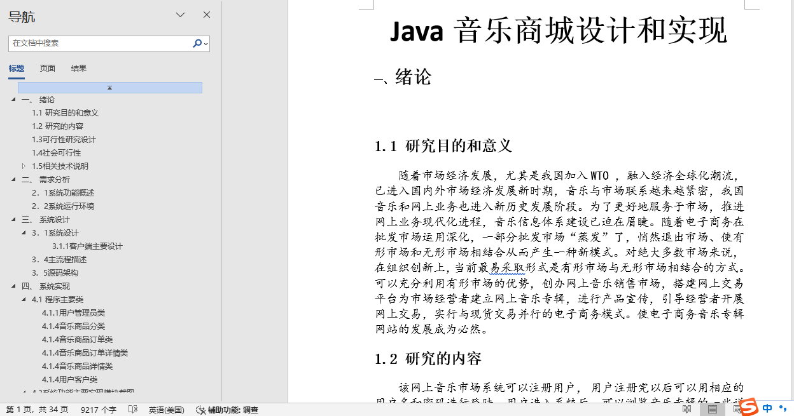


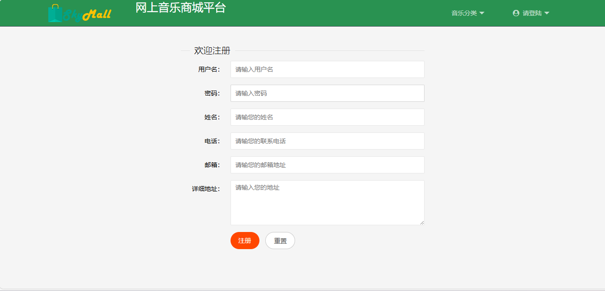

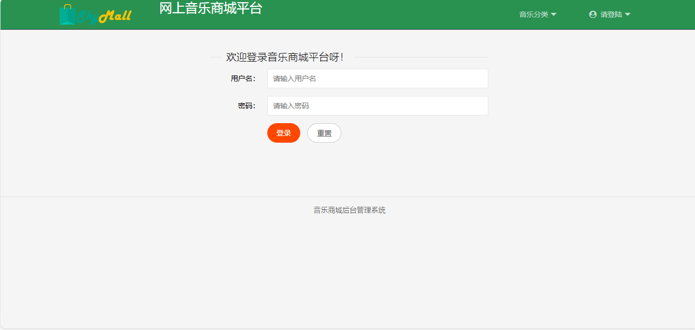

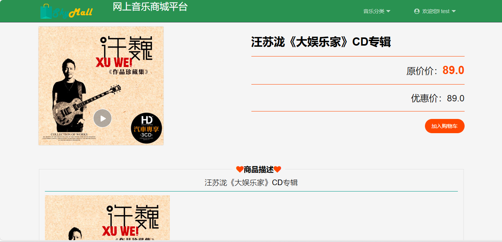

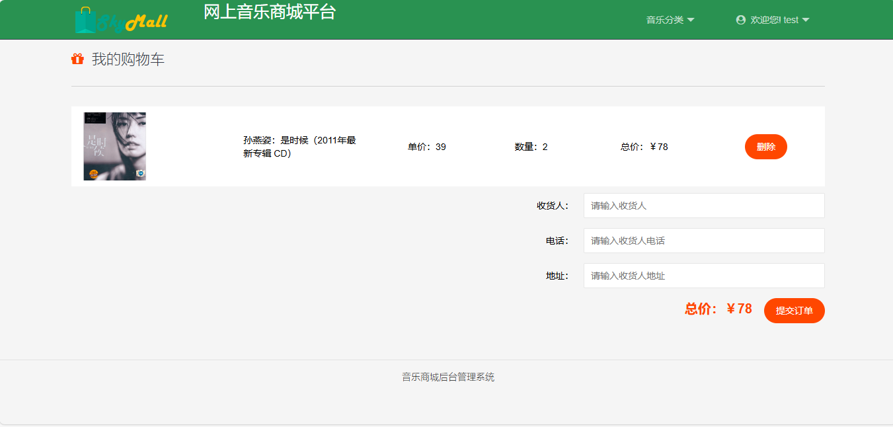

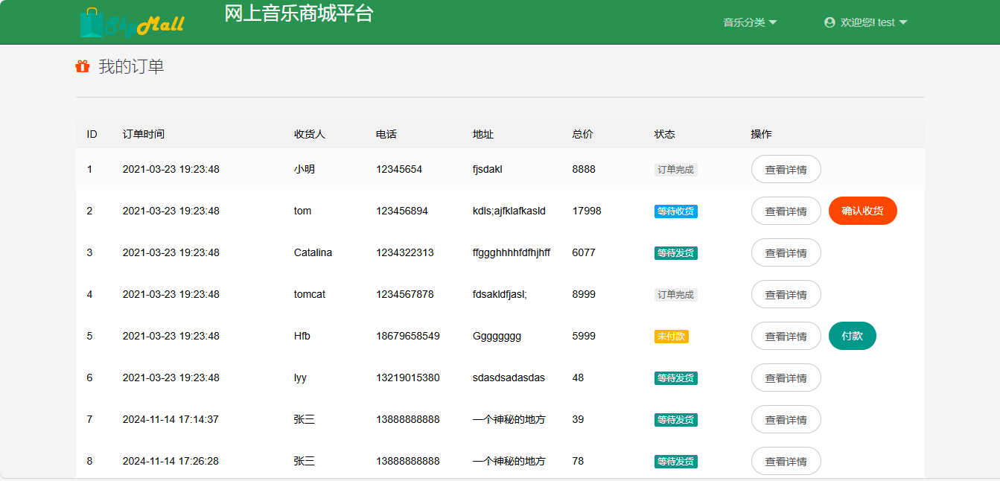

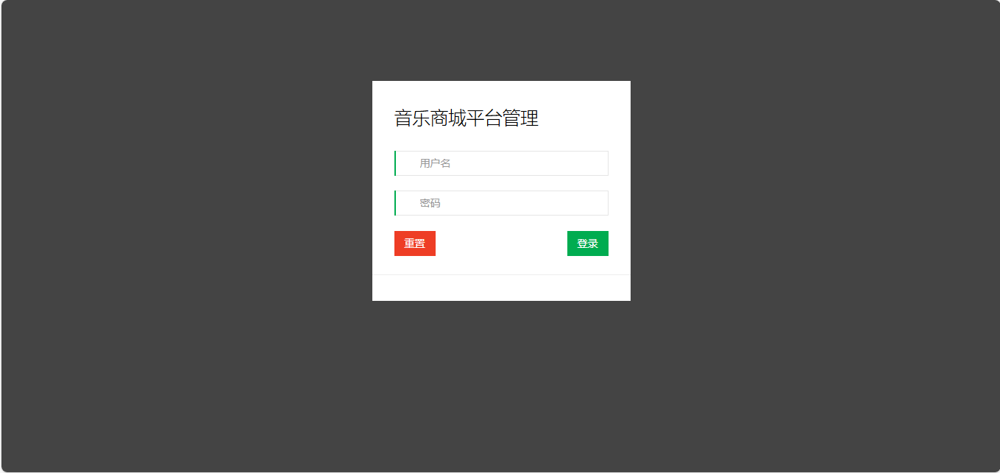

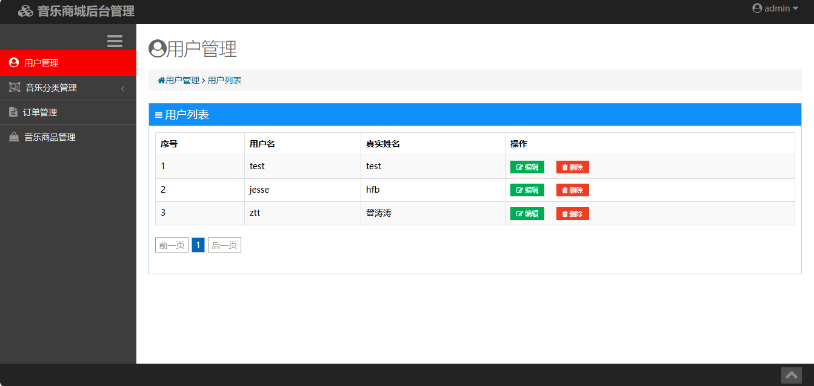

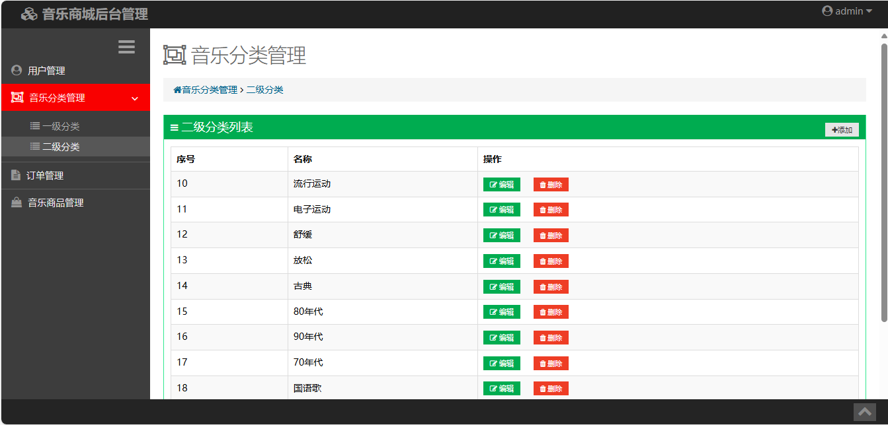

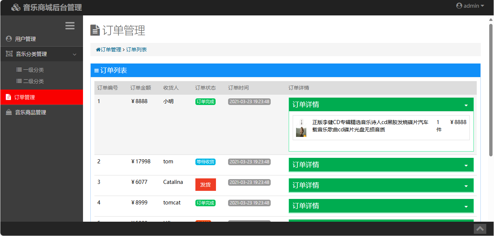

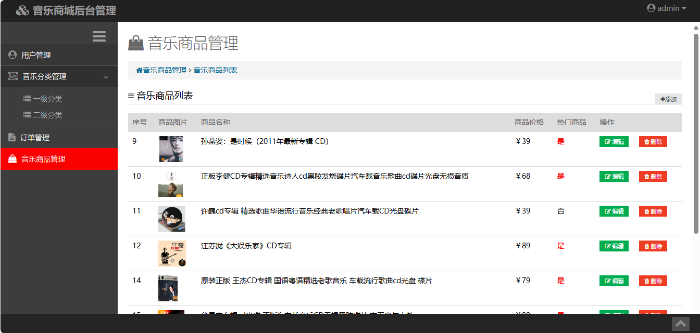

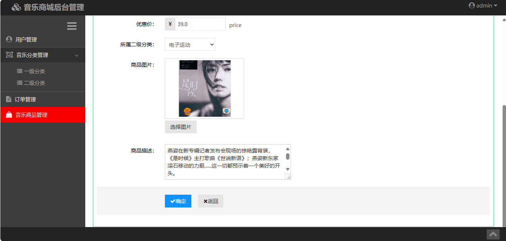